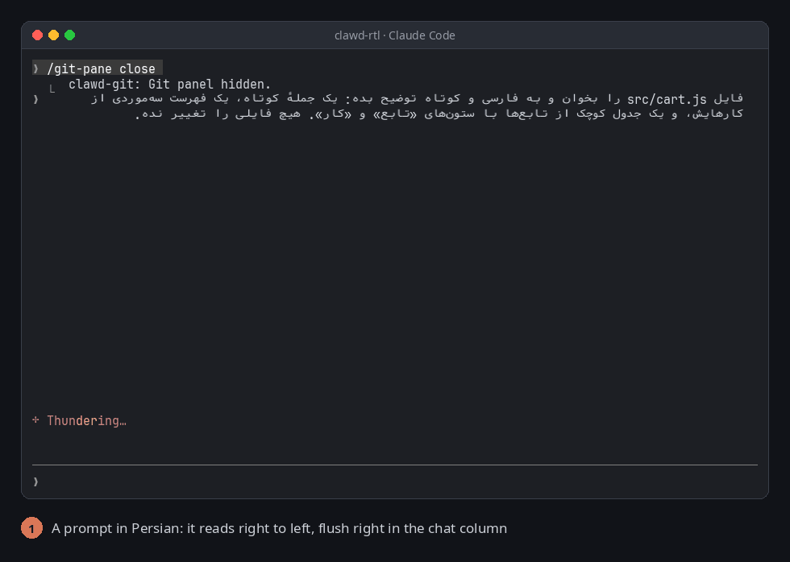

# clawd-rtl

Persian, Arabic and Hebrew in Claude Code read right to left. Claude's replies and your own prompts that hold right-to-left text start on the right of the chat column, with English words, numbers, lists, headings and tables in their right places. Side panels beside the conversation (like [clawd-git](https://github.com/itsomidho/clawd-git)) stay where they are.



Part of the [clawd mods](https://github.com/itsomidho/claude-plugins).

## Install

In Claude Code, type:

```
/plugin install clawd-rtl --marketplace itsomidho/claude-plugins
```

From a shell:

```
claude plugin install clawd-rtl --marketplace itsomidho/claude-plugins
```

## Terminal setup

clawd-rtl is made for VTE terminals (Guake, GNOME Terminal, Tilix, Terminator), which join Persian and Arabic letters and turn each right-to-left run themselves. Two things make it look right:

**1. A monospaced Persian font.** Without one, letters fall back to a font that does not fit the terminal's cells and show with gaps between them. [Vazir Code](https://github.com/rastikerdar/vazir-code-font) is made for terminals. Install it, then make it the fallback for your terminal font in `~/.config/fontconfig/fonts.conf` (replace `FiraCode Nerd Font` with the font your terminal uses):

```xml
<?xml version="1.0"?>
<!DOCTYPE fontconfig SYSTEM "fonts.dtd">
<fontconfig>
  <alias binding="strong">
    <family>FiraCode Nerd Font</family>
    <prefer>
      <family>FiraCode Nerd Font</family>
      <family>Vazir Code</family>
    </prefer>
  </alias>
</fontconfig>
```

Run `fc-cache -f` and restart the terminal (quit it fully; a new tab is not enough).

**2. The terminal's own direction detection off while Claude Code runs.** If you turned it on (`printf '\e[?2501h'`, so shell lines starting with Persian read right to left), the terminal flips each whole row, side panel included. For fish, [`extras/claude.fish`](extras/claude.fish) turns it off while `claude` runs and back on after; copy it to `~/.config/fish/functions/`. If you never turned it on, there is nothing to do.

## Use

There is nothing to turn on: once installed, every message that holds Persian, Arabic or Hebrew is drawn right to left, Claude's replies and the prompts you send alike. Messages with no right-to-left text, tool output and code blocks are drawn by Claude Code as always. To stop it, disable the plugin in `/plugin`.

## How it works

A VTE terminal orders every row with a left-to-right base direction, so a Persian line starts on the left, and a row the chat shares with a side panel can't be flipped as a whole. clawd-rtl draws each message that holds right-to-left text itself, inside the chat column only:

- it wraps the text to the column's width;
- puts each line's runs (Persian words, English words, numbers) in right-to-left order, mirroring brackets between them, and leaves each Persian run as written, because the terminal reverses and joins it;
- pads the line flush right and ends it with a blank braille cell (U+2800), a left-to-right character that draws nothing, so the terminal can't merge the line with a number in the panel beside it, or a Persian run with a number next to it.

Headings and bold text keep their style, lists keep their bullets and numbers on the right, tables list their columns from the right, and code blocks stay left to right. Messages with no right-to-left text are drawn by Claude Code as always.

## Limits

- The prompt box you type in stays left to right: Claude Code draws it, and a mod can't change it. Your message reads right to left once sent.
- Terminals that don't turn right-to-left runs themselves (Alacritty, kitty, most macOS terminals) show Persian runs reversed. clawd-rtl is for VTE terminals.
- Copying text from the terminal copies the blank cells (U+2800) too.
- Markdown is drawn by clawd-rtl, not by Claude Code, in these messages: no syntax colors in code blocks, and links show their text without the address.

## Troubleshooting

**Letters are disconnected or far apart.** The terminal is falling back to a font with no Persian letters that fit its cells; see Terminal setup, step 1.

**The side panel jumps to the left on rows with Persian.** The terminal's own direction detection is on; see Terminal setup, step 2.

**Lines start on the left.** The mod is off or not loaded: check `/plugin` for clawd-rtl.

## Development

```
claude --plugin-dir ~/Projects/clawd-rtl
claude plugin validate .
claude plugin test .
```

The layout lives in `hooks/rtl.tsx` and its tests in `tests/layout.test.ts`.

## License

MIT
